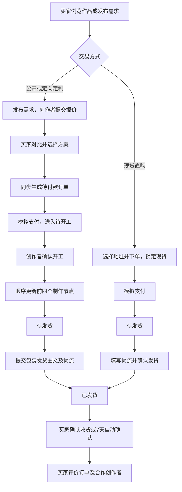
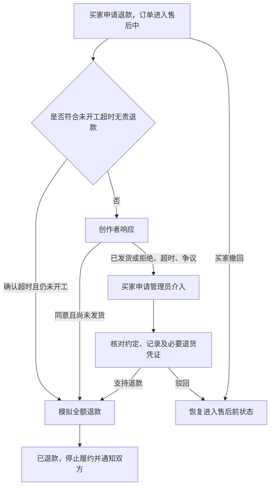

# 手工定制作品分享与交易平台需求规格说明书（精简版）

本版用于明确系统要实现的功能和业务流程，保留九个功能模块，重点突出多方报价对比、定制进度可视化和站内实时消息。系统提供电脑 Web 端，采用模拟支付；物流仅记录公司、单号及发货信息。

## 1. 用户角色与业务方式

### 1.1 用户角色

| 角色 | 可使用的主要功能 |
| --- | --- |
| 访客 | 浏览公开作品、搜索作品、查看创作者主页 |
| 买家 | 管理个人资料和地址、收藏互动、购买现货、发布定制需求、对比报价、支付、查看进度、收货、评价、申请售后 |
| 创作者 | 申请认证、发布管理作品、查看需求、提交报价、处理订单、上传制作进度、发货、响应售后 |
| 管理员 | 审核创作者和作品、管理用户和内容、处理举报及交易纠纷、维护品类标签、查看平台统计 |

同一账号默认具有买家身份，通过创作者认证后可以切换为创作者。身份切换只改变当前会话的功能入口，账号、订单和消息仍属于同一用户。创作者购买其他人的作品时，按该笔订单的买家权限操作。

### 1.2 业务方式

| 方式 | 入口 | 处理方式 |
| --- | --- | --- |
| 现货直购 | 已开启现货销售且现货可购买的作品详情页“立即购买” | 购买创作者手中已有的这件成品，支付后直接待发货 |
| 公开定制 | 买家“发布定制需求” | 需求进入大厅，多名创作者分别报价，买家选定一个方案生成订单 |
| 定向定制 | 已开启“接受定制”的作品详情，或有接单资格的创作者主页 | 以作品为参考，另行制作同类作品；仅指定创作者可查看和报价，后续复用定制订单流程 |

公开定制与定向定制共用需求单、报价和订单功能，只在可见范围及参与创作者上有所区别。

## 2. 详细功能需求

### 2.1 账号与身份

#### 2.1.1 邮箱注册、登录与密码找回

1. 用户填写邮箱，获取发送到该邮箱的验证码，设置密码后完成注册。
2. 邮箱为唯一登录账号，不允许重复注册；验证码为 6 位数字，5 分钟有效，同一邮箱发送间隔不少于 60 秒，单日最多发送 10 次。重新发送后旧验证码失效，验证成功后不可再次使用。
3. 密码为 8—20 位，包含字母和数字。登录使用邮箱和密码，连续 5 次密码错误后锁定 10 分钟。
4. 用户可退出登录；登录状态有效期为 7 天。未登录进行收藏、下单等操作时先登录，再返回原页面。
5. 忘记密码时，通过已注册邮箱接收验证码并设置新密码；重置后原登录状态失效，需要重新登录。
6. 邮箱验证码须实际发送并校验；手机号仅用于收货和联系。

#### 2.1.2 个人资料与收货地址

- 用户可查看、修改昵称、头像和个人简介；昵称 2—12 字，简介最多 200 字。
- 支持收货地址新增、修改、删除和设置默认地址，最多保存 10 条。
- 地址包含收件人、联系手机号、省市区和详细地址，至少有一条地址时须指定默认项。
- 下单或定标生成订单前选择收货地址，没有地址时先补充。订单保存当时的地址，后续修改个人地址不影响已有订单。
- 注册邮箱及收货信息不公开展示；订单创作者仅在履约所需范围内查看收货信息。

#### 2.1.3 创作者入驻与认证

用户提交以下材料后，由管理员一次审核，结果通过站内消息通知申请人。

| 材料 | 内容 |
| --- | --- |
| 基本信息 | 姓名、联系手机号、所在地 |
| 手艺信息 | 1—2 个主品类、从业年限、个人介绍 |
| 代表作品 | 1—3 件原创作品，至少包含一组制作过程图 |
| 补充证明 | 可选，用于辅助说明从业经历或作品原创性 |

- 管理员检查材料完整性、作品与过程图、品类及内容合规性，给出通过或驳回结果。
- 驳回必须说明原因，用户可修改材料后重新提交；通过后获得创作者权限。
- 认证是平台材料审核，不接入第三方实名认证或真实收款账户校验。
- 未认证用户不能发布作品和报价；暂停接单的创作者仍可处理已有订单、发货及售后。
- 管理员可以根据违规情况暂停或撤销创作者资格，并记录原因；不按长时间未发作品自动冻结。

认证状态：未申请、待审核、已认证、已驳回、已冻结、已取消认证。待审核可撤回；驳回可重提；冻结可由管理员恢复；已取消认证满 30 天后可重新申请。

### 2.2 作品与内容

#### 2.2.1 发布与管理作品

认证创作者可新增、编辑、保存草稿、提交审核、下架和重新上架作品。

**作品是一条展示内容，现货是创作者手中已经做好、可以直接出售的实物。** 作品可以展示现在持有的成品，也可以展示过去做过、已经卖出或不打算出售的成品；发布作品不等于出售现货。

发布时分别选择“是否出售现货”和“是否接受定制”，两个选项互相独立。两个都关闭也可以提交审核，通过后作为作品案例公开展示。

| 出售现货 | 接受定制 | 作品用途 | 买家入口（作品已上架且满足交易条件时） |
| --- | --- | --- | --- |
| 开启 | 开启 | 出售手中这件成品，同时接受另外制作同类作品 | 立即购买、发起同类定制 |
| 开启 | 关闭 | 只出售手中这件成品 | 立即购买 |
| 关闭 | 开启 | 不出售展示的这件成品，但愿意另外制作同类作品 | 发起同类定制 |
| 关闭 | 关闭 | 仅展示过去或现在完成的作品 | 浏览、点赞、收藏、评论，无直购和该作品的定制入口 |

例如，创作者发布一个已经做好的皮包：手里还有且愿意卖，开启“出售现货”；包已经卖了但愿意再做，关闭“出售现货”、开启“接受定制”；只展示过去的作品，两个都关闭。

| 字段 | 功能要求 |
| --- | --- |
| 标题 | 2—30 字 |
| 品类与标签 | 选择平台品类，选择最多 5 个风格标签 |
| 作品图片 | 1—9 张，首张为封面 |
| 材质与规格 | 说明主要材料、尺寸或其他规格 |
| 是否出售现货 | 必须选择；开启表示确有一件成品且愿意出售，关闭则不开放这件作品的直购 |
| 成品售价 | 仅开启“出售现货”时必填；大于 0，最多两位小数 |
| 运费 | 仅开启“出售现货”时必填；选择包邮或填写固定运费 |
| 是否接受定制 | 必须选择；开启表示愿意以作品为参考，另行制作同类作品，与是否出售现货无关 |
| 同类定制参考工期 | 仅开启“接受定制”时必填，3—180 个自然日；实际工期以单独报价为准 |
| 图文介绍 | 介绍制作工艺、使用场景、保养方式，可附过程图 |

- 仅开启“出售现货”的作品按一件现货管理，不做批量库存管理；仅展示或仅接受定制的作品不要求有现货，也无需填写现货售价和运费。
- 单件现货分为可购买、已锁定、已售出。创建待付款直购订单时锁定，取消或付款超时释放，支付后标记已售出。
- 同一时刻只允许一个未取消、未全额退款的直购订单，防止重复售卖。
- 现货售出后自动关闭直购入口，保留“已售出”记录；“接受定制”保持原设置，不会随现货售出自动开启或关闭。
- 一条作品可以承接多笔同类定制订单，每笔分别创建需求、报价和订单。定制是另外制作，不占用或锁定展示作品的那件现货；现货已售出也不妨碍继续接受定制。
- 原现货订单全额退款后，创作者确认成品仍在手中或已退回且可售，才可手动恢复直购；不能通过重新切换选项绕过已锁定或已售出状态。
- 后续关闭现货销售或接受定制，只停止对应的新交易入口，不取消已有订单。已上架作品关闭这两个选项后仍可继续展示，无需因此下架。

#### 2.2.2 作品审核

- 新作品提交后进入待审核，审核期间不能修改，可撤回为草稿。
- 管理员检查图片、描述、品类和违规内容；通过后公开展示，驳回后可查看原因并修改重提。
- 下架作品不参与搜索且不能新下单，但已有订单继续履约。
- 已上架作品修改图片、描述、品类等展示内容后须重新审核；修改不影响已有订单快照。

作品审核状态：草稿、待审核、已上架、已驳回、已下架。审核状态与现货可售状态分别记录。

#### 2.2.3 浏览、搜索与创作者主页

- 首页展示已上架作品，包括可售现货、仅接受定制和纯展示作品；支持关键词搜索及品类、价格、风格、是否可直购、是否接受定制筛选。
- 搜索匹配标题和描述；支持最新发布、价格升序及价格降序排序，列表分页展示。价格筛选只匹配当前可购买现货的售价；价格排序时其余作品排在可购买现货之后，不将未填价格视为 0 元。
- 作品详情展示图片、说明、材质规格、作者信息，并明确标注是否出售现货、是否接受定制；可直购时展示售价和运费，仅定制时提示价格及实际工期以报价为准，纯展示时不要求展示交易价格。
- 创作者主页展示简介、擅长品类、已上架作品、评分、评价数量和完成订单数。
- “立即购买”仅在作品已上架、开启“出售现货”且现货为可购买时开放；“发起同类定制”仅在作品已上架、开启“接受定制”且创作者有接单资格时开放。纯展示作品不显示这两个入口。

#### 2.2.4 互动与举报

- 登录用户可点赞、收藏作品及关注创作者；同一用户对同一对象仅保留一条有效关系，可取消。
- 用户可发表评论，支持文字及最多 3 张图片；用户只能删除自己的评论。
- 用户可举报作品、评论、评价或创作者，选择盗图、违规宣传、辱骂、引流等原因，并填写说明或证据。
- 管理员核实后可删除违规评论、隐藏违规评价、下架作品或限制账号，并通知相关用户。
- 正常差评不因评分低而自动删除，创作者不能直接删除他人评价。

### 2.3 定制需求

#### 2.3.1 发布需求

买家创建需求时填写一套通用表单，可保存草稿或发布。

| 字段 | 功能要求 |
| --- | --- |
| 需求标题 | 5—30 字，说明要定制的物品 |
| 品类 | 选择具体手工品类 |
| 材质与规格 | 说明材质、尺寸等要求，也可注明无特殊要求 |
| 风格与用途 | 选择风格标签，说明用途或场景 |
| 预算区间 | 50—50000 元，上限不低于下限 |
| 期望发货日期 | 发布后 7—180 天，不含物流时间 |
| 需求说明 | 20—2000 字，写明细节和验收要求 |
| 参考图片 | 最多 9 张，可选 |
| 收货地区 | 省市区，用于报价估算运费 |
| 需求范围 | 公开，或指定一名创作者 |

- 公开需求进入需求大厅，认证创作者可查看；定向需求仅买家与指定创作者可查看。
- 大厅仅展示买家昵称和地区，不公开联系方式、完整地址或历史订单。
- 同一买家同时处于待响应、报价中的需求最多 5 条。
- 发布后 24 小时内且从未收到报价时可编辑；收到首份报价后锁定正文，变更须关闭后重新发布。
- 定标前买家可关闭需求；关闭后所有有效报价失效，并通知参与者。

#### 2.3.2 需求大厅与沟通

- 创作者按品类、预算及发布时间筛选需求，查看说明、参考图、预算和期望发货日期。
- 只有已认证且主品类匹配的创作者可以报价；定向需求还须是被指定创作者。
- 买家和符合参与条件的创作者可围绕需求发起一对一会话，澄清材料、尺寸及方案。
- 不单独设置需求公开留言区，所有方案沟通保存在关联会话中。
- 用户不能对自己发布的需求报价，也不能购买自己发布的作品。

#### 2.3.3 需求状态与有效期

| 状态 | 说明 |
| --- | --- |
| 草稿 | 尚未发布，可编辑、发布或删除 |
| 待响应 | 已发布，当前没有有效报价 |
| 报价中 | 至少有一份有效报价，买家可对比和定标 |
| 已定标 | 已选中方案，并生成待付款订单 |
| 交易进行中 | 订单已支付，仍在履约或售后窗口中 |
| 已完成 | 订单完成且 7 天售后窗口结束，无处理中售后 |
| 已关闭 | 买家主动关闭，或订单取消、全额退款 |
| 已过期 | 尚未定标，发布满 7 天且没有有效报价 |

过期判断仅适用于待响应、报价中的需求，已定标或已进入交易的需求不参与。发布满 7 天仍有有效报价时，可在报价有效期内继续定标。全部报价失效或撤回后，发布未满 7 天回到待响应，已满 7 天则过期。关闭或过期后只可复制为新需求，不继承原报价。

### 2.4 多方报价对比

#### 2.4.1 提交与撤回报价

创作者根据需求提交独立方案，不查看其他创作者的报价。

| 字段 | 功能要求 |
| --- | --- |
| 报价金额 | 50—50000 元，最多两位小数 |
| 预计工期 | 3—180 个自然日，从实际支付次日零时起算 |
| 方案说明 | 30—1000 字，说明材料、工艺及制作方案 |
| 材料清单与修改约定 | 可选，说明用料和方案修改范围 |
| 效果图或草图 | 最多 5 张，可选 |
| 运费 | 说明是否包邮，未包邮时填写运费 |

- 每名创作者对同一需求同时只能有一份有效报价，同一需求最多同时接收 5 份有效报价。
- 报价固定 7 天有效，定标前可撤回；撤回或到期后，可在需求仍开放且未满额时重新提交，历史记录保留。
- 报价撤回、到期或需求关闭后不能再被选中；有空位时可接收新报价。
- 报价提交后通知买家，撤回或失效同样更新买家端状态。
- 系统根据工期测算预计发货日，并提示该日期按当前付款测算；付款后确定最终日期。明显晚于买家期望时，在选择方案前提示确认。

#### 2.4.2 报价对比页

仅需求所属买家可进入，使用一张对比表展示各份报价，支持展开完整方案及查看图片。

| 对比信息 | 展示内容 |
| --- | --- |
| 金额 | 报价、运费、合计金额，标记最低合计价 |
| 工期 | 制作天数、预计发货日，标记最短工期 |
| 方案 | 方案说明、材料清单、修改约定 |
| 图片 | 效果图或草图 |
| 创作者 | 昵称、擅长品类、平均评分、评价数、完成订单数 |
| 有效期 | 报价截止时间；已失效方案不可选择 |

对比页显示当前有效报价数量，例如“3/5”，支持按合计金额、工期和评分排序。

#### 2.4.3 选择方案与生成订单

1. 买家选择一份有效报价，确认金额、运费、工期、方案及收货地址。
2. 确认后，选中报价变为已中标，其余有效报价变为未中标，同时生成唯一待付款订单。
3. 上述操作要同时成功；创建订单失败时，本次定标不生效，需求与报价保持原状态。
4. 系统通知中标和未中标创作者，不向未中标者披露其他人的报价及方案。
5. 买家须在订单创建后 24 小时内支付，超时自动取消订单并关闭需求。
6. 定标后不能换选其他报价。未支付可以取消订单；如需另选方案，重新发布需求。

报价状态：待买家查看、已查看、已中标、未中标、已失效。待买家查看和已查看且未到期的报价才属于有效报价。

### 2.5 订单与交易

#### 2.5.1 下单与订单信息

- 现货订单仅从允许直购的作品创建，金额取成品售价与运费；定制订单由选中报价生成，金额取报价与约定运费，与参考作品是否出售现货、是否已售出无关。
- 订单展示编号、类型、买卖双方、作品或需求标题、金额明细、收货地址、状态和操作记录。
- 定制订单额外保存工期、方案、材料、效果图及约定发货日。现货不设置制作工期和制作进度。
- 订单保存成交时的价格、运费、方案和地址，作品或个人资料后续修改不影响原约定。
- 重复点击下单、支付或定标不能生成重复交易或重复扣款。

#### 2.5.2 模拟支付与取消

- 使用一个模拟支付入口，确认后记录支付结果、金额、时间及流水号，不做余额钱包、充值、提现或真实分账。
- 待付款订单可以取消；创建后 24 小时未支付自动取消。现货释放锁定，定制关闭需求。
- 支付成功后，现货直接待发货；定制进入待开工。
- 定制付款前确认“制作开始后不支持无理由退款”。现货展示现货售后说明。
- 定制支付后超过 48 小时未开工，买家可申请无责全额退款；制作开始后不能单方直接取消，须走售后。

#### 2.5.3 履约、发货与收货

- 现货默认支付后 48 小时内发货；定制按约定工期制作，从支付次日零时起算，包含等待开工的时间，不含物流时间。
- 待发货时由创作者填写物流公司与运单号，确认后变为已发货并通知买家；不接入物流轨迹服务。
- 运单填错可在确认收货前更正，并保留修改记录、通知买家。
- 买家收到商品后确认收货；发货满 7 天且无处理中售后，系统自动确认，订单变为已完成。
- 售后期间暂停自动确认倒计时，恢复已发货后顺延售后占用的时间。
- 超过约定发货时间仍未发货时标记超期并提醒双方，买家可沟通或申请售后。

#### 2.5.4 退款与纠纷处理

首版保留全额退款协商及平台介入，返修、部分退款不作为独立业务流程。

1. 买家可在已付款履约期间，或订单完成后 7 天内申请退款，填写原因并上传最多 3 张凭证图。
2. 每个订单同时只允许一条处理中退款申请；发起后订单进入售后中，保存进入前的订单状态。
3. 创作者在 48 小时内同意或拒绝并说明原因。未发货订单同意后模拟退还实付金额，记录退款流水，订单转为已退款；已发货订单须转管理员核实，不直接执行退款。
4. 创作者拒绝、超时未响应，或双方无法达成一致时，买家可申请管理员介入。
5. 管理员查看订单约定、制作记录、会话和凭证，决定退款或驳回，填写理由并通知双方；由一名管理员处理并留痕。
6. 申请被驳回或买家撤回后恢复原订单状态；退款成功后停止履约，关闭关联定制需求，不再恢复原报价。
7. 已发货退款由管理员核实退货约定和退回情况后处理，保留退回单号或凭证；无需退货的处理须明确记录理由。未发货退款不要求退货。
8. 因未开工超时产生的无责退款不要求创作者同意；已确认超时且尚未开工时可直接模拟退款。

双方需要延长未发货定制订单工期时，可发起延期请求，填写新发货日和原因，对方确认后生效，保留原日期与协商记录。

#### 2.5.5 订单状态

| 状态 | 适用订单与进入条件 |
| --- | --- |
| 待付款 | 两类订单创建后，等待买家支付 |
| 待开工 | 仅定制订单，已支付、创作者未确认开工 |
| 制作中 | 仅定制订单，创作者已确认开工 |
| 待发货 | 现货付款后，或定制前四个制作节点处理完 |
| 已发货 | 创作者确认物流信息并发货 |
| 已完成 | 买家确认收货或系统自动确认 |
| 售后中 | 有处理中退款申请 |
| 已退款 | 全额退款完成，履约终止 |
| 已取消 | 未付款订单主动取消或超时取消 |

已完成订单仍可在完成后 7 天内申请退款；已退款、已取消为终态。售后被驳回或撤回时恢复进入前的合法状态，不能一律转为已完成。

### 2.6 定制进度可视化

#### 2.6.1 制作阶段与计划

仅定制订单生成以下五个节点，现货不显示制作时间轴或打卡入口。

| 顺序 | 阶段 | 主要记录 |
| --- | --- | --- |
| 1 | 备料 | 材料准备、裁切及预处理 |
| 2 | 打样打版 | 样品、草模或纸样；不适用时可填写原因跳过 |
| 3 | 制作 | 主体加工、缝制、雕刻、烧制等 |
| 4 | 质检 | 尺寸、外观及工艺检查 |
| 5 | 包装发货 | 包装、防护、物流公司及运单号 |

付款后按总工期生成参考计划，五节点累计占比为 15%、35%、80%、90%、100%，向上取整到自然日。创作者确认开工后解锁第一个节点；双方确认延期时，更新尚未完成节点的计划日期并保留原计划。

#### 2.6.2 创作者更新进度

- 每节点提交 1—6 张实拍图和 5—500 字说明，内容包括本阶段完成情况及需要沟通的问题。
- 按顺序更新，上一个节点完成或允许跳过后才解锁下一个；仅打样打版可以填写原因跳过。
- 原始打卡记录不可删除或覆盖，可追加补充说明和图片。
- 前四节点处理完后，订单进入待发货；第五节点的图文与物流信息一起提交，成功后节点完成、订单变为已发货。
- 每次进度更新立即通知买家，记录提交时间及操作人。

节点状态为未开始、已解锁、已打卡、已跳过。已打卡和已跳过不能撤销，跳过须保留原因和时间。

#### 2.6.3 买家查看进度与超期

- 订单页展示进度条、阶段时间轴和图集，包含计划日期、实际日期及偏差天数。
- 进度按已打卡与已跳过的节点数计算，例如 3/5；发货后为 5/5，不代表买家已经收货。
- 买家只可查看，不可修改节点；需要确认细节时，从进度页进入订单会话沟通。
- 节点超过计划时间时显示超期；超期 24 小时提醒创作者，72 小时提醒双方并标记异常。
- 全额退款、取消或售后暂停期间不继续累加节点提醒；同一异常去重处理，不因重复检查多次计数。
- 节点计划用作进度参考，不仅因未上传照片自动冻结创作者，必要时由管理员结合证据处理。
- 完成后的制作记录保留，供双方查看和纠纷核实。

### 2.7 买家评价与创作者口碑

#### 2.7.1 提交评价

- 仅订单买家可评价本人参与且已完成的订单及合作创作者。创作者不评价买家，也不能评价自己作为卖方参与的订单。
- 完成后 7 天内可提交，每个订单一条；售后处理中、已取消和已退款订单不能新建评价。
- 一条评价同时关联订单与创作者，在订单详情和创作者主页展示，买家无需重复填写。
- 评价包含 1—5 星总体评分、10—500 字文字及最多 3 张图片，提交后不自行修改。

#### 2.7.2 口碑展示与管理

- 展示创作者平均评分、评价数量、好评率和完成订单数。4—5 星计为好评，好评率为有效好评数除以有效评价数。
- 无评价时显示“暂无评价”，不默认判为低信用；不使用复杂百分制信用模型或信用分自动限权。
- 评价可被举报，管理员核实后隐藏或删除违规内容，保留处置记录。
- 统计排除已隐藏或删除的评价；合法差评仍展示并计入评分。

### 2.8 站内实时消息

#### 2.8.1 通知中心

通知用于单向告知业务变化，用户可查看列表、详情、未读数量并标记已读，点击后跳转对应业务。

| 通知类型 | 触发事件 |
| --- | --- |
| 审核通知 | 创作者认证或作品审核完成 |
| 报价通知 | 新报价、报价撤回或失效、方案被选中或未被选中 |
| 订单通知 | 支付、取消、开工、发货、收货及超时 |
| 进度通知 | 节点更新、进度超期、延期请求与确认 |
| 售后通知 | 申请退款、创作者响应、平台处理及退款结果 |
| 互动与系统通知 | 评论、关注、举报结果和平台公告 |

#### 2.8.2 需求与订单会话

- 买家和创作者可围绕具体需求或订单进行一对一沟通，不提供无关联的陌生人私聊。
- 消息支持 1—500 字文字，或最多 3 张图片；允许仅发送图片。
- 会话列表按最新消息排序，展示对方信息、关联需求或订单、最后消息和未读数。
- 进入会话后标记已读，支持查看历史消息；内容只对会话双方及处理相关纠纷的管理员开放。
- 定标后，中标创作者的原需求会话继续关联订单；未中标者的会话只读归档。
- 不单独建设需求留言、节点评论等重复沟通功能；已有订单的必要业务沟通不因暂停新接单而关闭。

#### 2.8.3 实时收发与限制

- 在线时通过 WebSocket 推送新消息和通知；离线消息先保存，登录或重连后可查询未读与历史内容。
- 建连使用登录身份校验，不能自行指定他人的用户身份接收消息。
- 消息以唯一编号去重，同一用户多端在线时同步推送和刷新已读状态。
- 在线消息应在 3 秒内到达；网络断开时尝试重连，失败后可手动刷新查询。
- 同一发送人在同一会话 60 秒内最多发送 20 条消息；发送过快时短暂限制。
- 文本过滤明显辱骂、违规和站外引流内容；正常收货及物流字段不参与联系方式拦截，图片违规通过举报处理。

### 2.9 后台管理

#### 2.9.1 审核中心

- 查看待审核创作者与作品列表、提交材料、提交时间和历史审核记录。
- 可通过或驳回，驳回填写具体原因，结果通知申请人。
- 队列按提交时间排序，超过 3 个工作日未处理时标记超时，方便管理员优先处理。

#### 2.9.2 用户与内容管理

- 按邮箱、昵称、认证状态查询用户，查看其公开内容及相关业务记录。
- 对违规用户警告、暂停新接单或限制发布，记录原因；严重问题撤销创作者资格。
- 暂停新业务时保留已有订单的发货、沟通及售后入口。
- 查询作品、评论、评价与举报，对违规内容下架、隐藏或删除，并通知相关用户。
- 管理员不能以内容治理为名直接改写订单原始约定或制作记录。

#### 2.9.3 订单与退款管理

- 按订单号、状态、类型、日期和金额查询订单，查看支付、物流及退款记录。
- 优先展示待处理售后、未开工超时、发货超期等异常订单。
- 处理纠纷时查看订单快照、进度图文、会话和证据，记录结论及原因。
- 审核、限制、下架和退款等重要操作记录管理员、对象、时间、动作及原因。

#### 2.9.4 品类、标签与公告

- 新增、编辑、停用品类和风格标签，供作品、需求及认证表单使用。
- 停用后新内容不可选，历史内容保留原信息。
- 发布和管理平台公告，按全体用户或指定角色发送系统通知。

#### 2.9.5 基础数据统计

展示用户总数、新增用户数、认证创作者数、作品数、需求数、订单数、模拟支付金额和待审核数量。注册用户与认证创作者分别统计，避免同一账号重复计入新增注册数。

## 3. 核心业务流程

### 3.1 创作者入驻与发布作品

邮箱注册并登录 → 提交创作者材料 → 管理员审核 → 通过后获得创作者身份 → 发布作品并分别选择是否出售现货、是否接受定制 → 作品审核通过 → 公开展示，并按选项及现货状态开放对应入口；两个选项均关闭时只展示作品。

认证或作品审核被驳回时，查看原因、修改后重新提交；不影响账号继续以买家身份使用。

### 3.2 现货与定制订单流程

- 所有待付款订单均须在创建后 24 小时内支付，超时取消。
- 公开定制允许多名创作者报价，定向定制只允许指定创作者报价；后续履约相同。
- 现货全程不出现待开工、制作中和制作进度打卡。
- 纯展示作品不直接进入上述交易流程；仅接受定制的作品可发起新的定制需求，另行报价制作。

### 3.3 退款与平台介入

退款、定标和支付都保留操作结果；重复请求不重复执行。正常履约中的订单不能通过手工改状态绕过上述流程。

## 4. 必要通用约束

- 登录、角色和资源归属由服务端校验：只能操作自己的需求、报价和订单；不能通过修改请求查看他人私密信息。
- 图片支持 jpg、jpeg、png、webp，单张最多 5MB；各功能的数量限制以对应章节为准。
- 金额保留两位小数；必填、格式和范围校验失败时说明具体原因，并保留用户输入。
- 密码使用加盐哈希保存；评论及会话内容过滤脚本，上传图片检查实际格式。
- 定标、支付、退款、下架等关键动作需要确认；业务状态变化、审核结论与交易记录可追溯。
- 模拟交易也须防止重复下单、重复付款、重复退款，以及同一件现货被多人同时购买。
